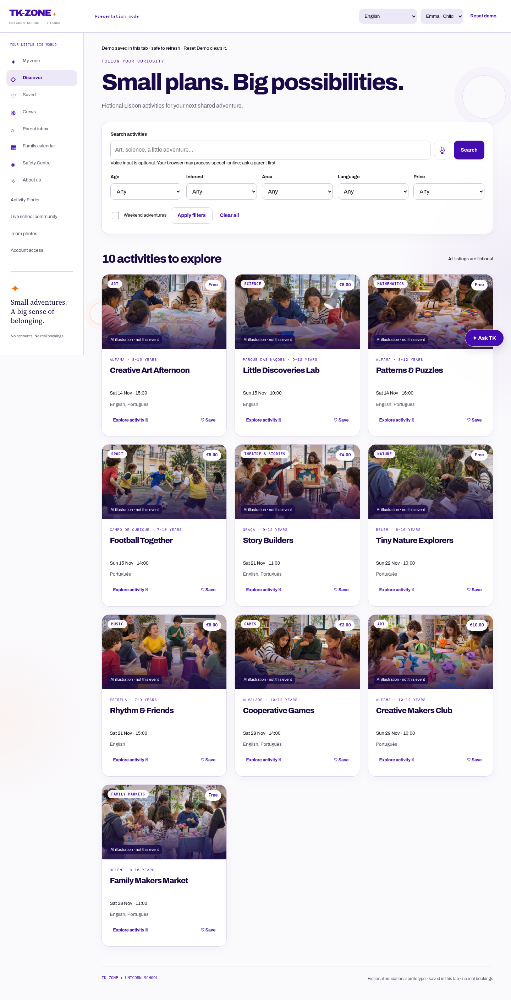
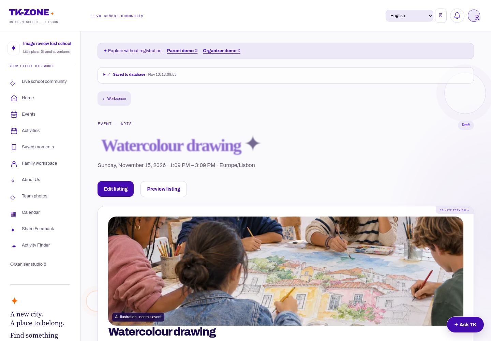

# Activity-first event images

## Current catalogue audit

The ten fictional demo records were reviewed by title, English/Portuguese descriptions, age range, category and neighbourhood. They do not supply exact venues or explicit indoor/outdoor classifications. The manually selected scenes therefore illustrate plausible settings, **never confirmed venues**. Every image is labelled **AI illustration · not this event** and has a description of what it actually shows. All people are synthetic; no real children's photographs or personal data were used.

| Demo activity | Main image subject | Illustrative setting / approximate ages |
|---|---|---|
| Creative Art Afternoon | Drawing and watercolour together | Indoor Portuguese-style arts studio, 10–13 |
| Little Discoveries Lab | Light/prism experiment | Indoor learning room, 9–12 |
| Patterns & Puzzles | Geometric shapes and tangrams | Indoor classroom table, 8–12 |
| Football Together | Football and ball skills | Modest local outdoor pitch, 7–10 |
| Story Builders | Creating and acting out stories | Indoor community drama room, 9–12 |
| Tiny Nature Explorers | Observing and sketching plants | Leafy Lisbon-compatible garden, 10–13 |
| Rhythm & Friends | Homemade shakers, sticks and buckets | Indoor community music room, 7–9 |
| Cooperative Games | Cooperative tabletop board game | Indoor community room, 10–12 |
| Creative Makers Club | Paper sculptures | Indoor makers table, 10–12 |
| Family Makers Market | Families exploring handmade paper crafts | Covered outdoor community courtyard, 10–13 |

An eleventh library scene shows children aged approximately 8–12 painting/crafting at a park picnic table. It handles outdoor art workshops without substituting the indoor studio or a Lisbon landmark.

The local development database contained no live listings to audit directly. Existing live records are evaluated from their actual fields when rendered. Unknown legacy uploads are not silently declared accurate: their files are preserved, but they need review before being displayed as event covers.

## Selection for future events

`content/activity-imagery.json` records scene subjects, age cohorts, setting, exclusions and English/Portuguese alt text. `community/activity_imagery.py` and the pure browser module `activity-imagery.js` apply equivalent conservative rules:

1. Read title, description, category, ages, venue, area and indoor/outdoor metadata.
2. Require a specific activity match, a compatible age cohort, Lisbon-compatible context and the correct setting.
3. Reject known contradictions, such as an indoor studio marked outdoor, piano versus percussion, or console gaming versus a board game.
4. Use a neutral activity placeholder when context is missing, conflicting or unsupported. No city/landmark fallback is allowed.

The ten initial demo assignments have reviewed-detail fingerprints, including both language versions. Editing those details invalidates the assignment and uses the same future-event rules. There is no automatic image-generation bill or external image call on page views. Additional subjects need a properly reviewed upload or a new curated library entry.

## Uploaded images

The organiser/staff editor provides alt text, source type and an explicit final-step image review with a card-style crop preview. The organiser confirms activity, ages, venue and usage permission. Event photos, stock and generated images have separate, truthful captions. This is **human attestation**, not an AI vision check, a licensing guarantee or a safety certification.

Reviewed uploads require event details, ages and setting, meaningful alt text and a stated source. Relevant form edits clear the confirmation. A server-computed signature binds the image filename, alt text/source and event details. New files and changes to subject, ages or venue invalidate prior review, including changes outside the browser. Signatures are created after the final stored filename exists, supporting `save(commit=False)` workflows.

Migration `0012_activity_image_review` adds metadata only. It preserves event data and image files and starts legacy uploads as unreviewed. Organisers can review/reuse an appropriate existing upload. Incompatible or unknown uploads remain hidden behind an appropriate activity illustration or placeholder. Existing account, school and private-media permissions continue to apply.

## Presentation and assets

Eleven distinct, photorealistic illustrations were generated specifically for this project on 10 November 2026. Each is bundled as 768px/1536px WebP, with meaningful alt text and explicit disclosure. Activity-centred card crops preserve the table, experiment, ball or craft; Lisbon provides visual context, not the focal landmark. Subjects are not reused across unrelated activities. Stock/organiser photos are never invented or attributed to a photographer without evidence.

`tk-zone-share.png` remains a generic project-brand preview, not a per-event photograph. Its city illustration is disclosed; it makes no claim to show a listed event.

## Verification

Tests cover all ten unique assignments, indoor versus outdoor art, age mismatch, unknown/conflicting settings, subject exclusions, English/Portuguese edit invalidation, server/browser parity, image dimensions/weight, uploaded-image alt/source review, review invalidation, protected media and responsive card/detail rendering. Browser image checks decode every catalogue image before capturing screenshots. Demo network tests allow only same-origin static image loads and language dictionaries; business actions still cannot contact external services.

Final local validation: 249 backend tests, 30 browser journeys, 30 JavaScript tests, syntax checks, migration checks and the Vercel preview build command passed. Fourteen image-specific backend/browser tests passed again after final asset, source-label and conservative matching refinements. Production deployment and any live uploads needing organiser review have not been inspected from this environment.

