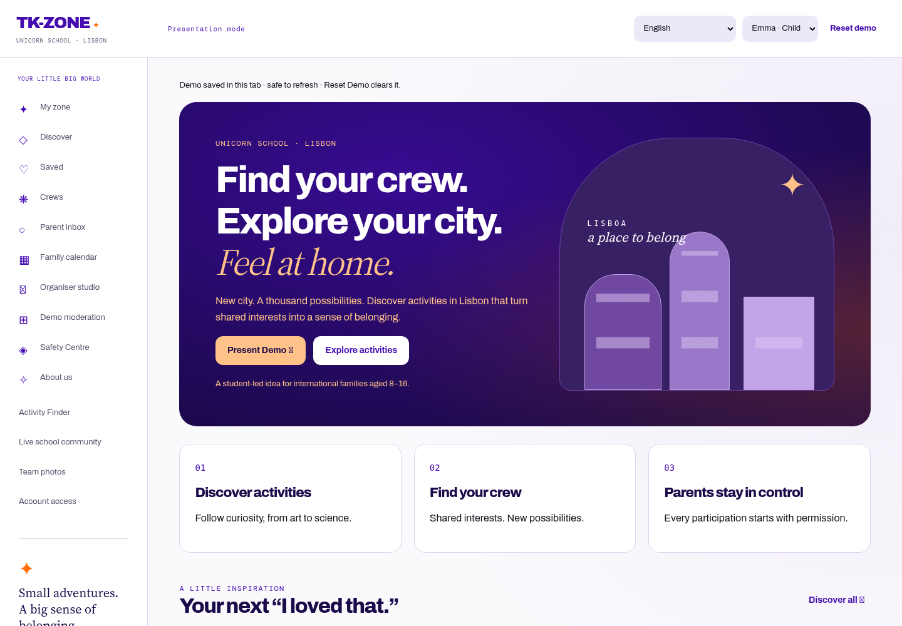

# AI visual effects

Shared `ai-effects.css` and `ai-effects.js` enhance the existing Django product shell, including Demo, Community and Finder. No additional API calls, dependencies or stored data are introduced.

- Purple/orange decorative hero glow settles after 4.5 seconds; AI stars shimmer twice, then rest.
- Translucent cards retain near-opaque reading surfaces, with solid fallbacks when blur is unsupported or reduced transparency is requested.
- Activity cards lift only on devices with hover and a fine pointer. Keyboard focus retains a visible border.
- Genuine AI match explanations and parent summary commentary receive a brief typing reveal, capped at 1.8 seconds. This is a visual effect after a complete response, not token streaming. Errors, forms and moderation flags display immediately.
- Complete answers remain in the accessibility tree from the start; the visual reveal is hidden from screen readers. Full text reserves paragraph height to prevent layout jumps. Escape finishes the reveal.
- System reduced motion and the existing accessibility preference disable animation. Switching reduced motion on immediately reveals running answers. State rerenders do not replay cached answer effects.

## Verification

`python manage.py test community.browser_ai_effects --noinput` checks computed glow/blur/hover styles, reduced motion, complete accessible answers and widths 360, 390, 768 and 1440 on Demo, Community and Finder. AI responses are intercepted in this browser test; it does not verify a paid Claude request.

Validated locally: 225 Django tests, 24 Chromium journey tests, 25 JavaScript tests, JavaScript syntax checks and the Vercel preview build command passed. The browser tests include mocked AI responses; hosted deployment and paid-provider operation are separate checks.

