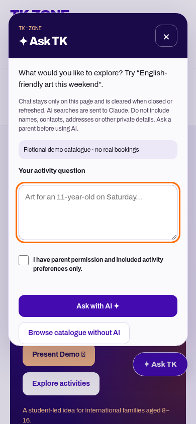

# Ask TK

The floating launcher is loaded by the shared Django base and demo templates, including child, parent, organiser, staff, authentication, Community, Finder and About pages. Django's separate system administration interface and server error pages are not modified.

## Behaviour

- A native modal dialog provides keyboard focus containment, Escape/close, focus return, visible focus and a mobile layout above navigation. English and European Portuguese copy follow the interface language.
- AI uses the existing server-only `ANTHROPIC_API_KEY` and model configuration to interpret a single preference question. No extra credentials are required. It does not implement a general-purpose chatbot or retain conversational context.
- Live suggestions use the existing authorised catalogue policy, upcoming available event/session checks and validated filters. The provider never supplies links, activities, contact details or booking decisions. Weekend queries cover both Lisbon-calendar weekend days.
- Demo suggestions use only the current in-memory approved fictional catalogue, including approved organiser additions and cancellations. The endpoint returns interpreted filters without reading live listings in demo scope. Demo profiles and catalogue contents are never sent to Claude by this feature.
- No credits, missing key, errors or rate limits produce an explicit message. **Browse catalogue without AI** uses the catalogue directly, with no provider request and no AI claim.
- Suggestions link to event details; the existing parent-controlled participation workflow remains required.

## Privacy

Chat questions and responses live only in the panel DOM and pending request memory. They are not written to the database, browser storage, analytics or server application logs by this feature. Close, navigation or reload clears them. There is no persistent chat history or query cache. Responses use `Cache-Control: no-store`.

AI questions are sent to Anthropic after the user's preference-only/parent-permission confirmation. The panel says not to include names, addresses, contact information or private details. Obvious email, URL and telephone patterns are rejected before the provider call; this is not a complete personal-data detector. Provider retention is governed by the account's Anthropic settings, not by this app. Never promise that a third party retains nothing. Existing middleware records hashed actor/path rate-limit attempts, not message bodies.

The endpoint requires POST and CSRF, validates payload length and fields, uses existing server-side rate limits and does not mutate participation data. Text is rendered via `textContent`, and suggestion links are constrained to catalogue detail routes.

## Verification

`python manage.py test community.test_ask_tk community.browser_ask_tk --noinput` verifies consent, error handling, private-school access, demo isolation, two-day weekend resolution, zero-provider browsing, keyboard close/focus, mobile geometry, reset on close/reload, mocked AI matches and Portuguese copy. Provider calls in these tests are mocked; paid API operation and Vercel readiness require separate verification.

Local verification: 232 Django tests, 26 Chromium journey tests, 25 JavaScript tests, syntax checks and the Vercel preview build command passed. After final date-validation and mobile-focus refinements, all nine assistant-specific backend/browser tests and the build command passed again.

