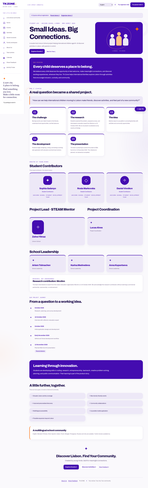
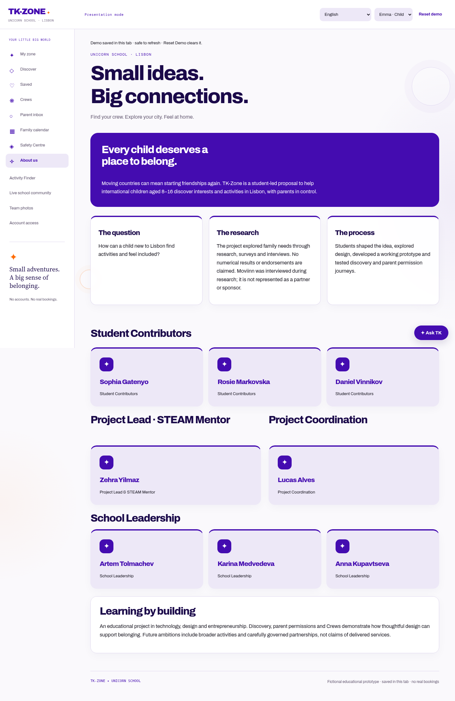

# Brand and role consistency

## Visual treatment

The final shared `brand-refresh.css` uses the home palette: primary violet `#440CB0`, dark violet `#1B0A4A`, orange `#FF6B00`, light violet `#EDE8F7` and peach `#FFC38A`. Existing neutral reading surfaces remain. Right-side city/hero graphics, warning accents and About Us no longer introduce their own violet/orange swatches. Uploaded photography is unchanged.

About Us gains purple mission/learning panels, lavender contributor cards, purple borders and badges, and small orange accents. Both live About Us and the demonstration version use this treatment. Decorative background rings/washes are static, pointer-inert and behind content. No new palette colours or motion are introduced; forced-colour mode hides the decoration.

## Name correction

`content/project.json` identifies contributor `student-1` as **Sophia Gatenyo**. IDs and image URLs remain stable. Legacy portrait lookup recognises the old spelling during rollout, while displayed names/descriptions use the corrected spelling. Staff replacement/deletion handles both spellings to avoid leaving an older public portrait behind.

Migration `0011_correct_sophia_name` corrects matching Unicorn School portrait names, captions and descriptions, plus exact matching first/last names on school-member accounts. It preserves photo IDs, image bytes, sharing flags, guardian consent, roles and login identifiers. Other schools remain unchanged. Historical migrations keep their original names so existing upgrade paths remain reproducible. The data correction intentionally has a no-op reverse instead of reintroducing the spelling error. The standard production Vercel build applies migrations; preview builds do not modify the production database.

## Roles and access

- Verified organiser membership is required for the live Organiser Studio, its new/edit forms and posting actions. An unauthorised signed-in account receives HTTP 403 instead of being redirected into the organiser application flow.
- Child and parent accounts no longer receive organiser navigation or demo-studio links. The separate adult application endpoint remains available for requesting reviewed posting access; an application is not studio permission.
- Existing staff moderation and delegated event management remain protected by their established staff permissions.
- Signed-in demonstration roles are derived on the server from the account. Child, parent and unverified-organiser accounts cannot open organiser/creator demo routes or invoke demo drafting/moderation APIs by changing URLs or JSON fields. The role selector is locked to their account role; restored browser state cannot switch it.
- Registration-free guest presentations retain an explicitly fictional role picker. Guest child/parent roles do not display Organiser Studio. Opening a navigation target no longer silently switches into the organiser/admin role; use the picker explicitly. These guest simulations never grant real organiser permissions or mutate real event records.

## Verification

Targeted tests cover HTTP access and forged roles, verified organiser access, account-bound demo options, legacy portrait handling, name migration idempotence/privacy, computed brand colours, About Us and 390/768/1440px layouts. Broader existing suites check that discovery, parent approval, organiser submission and moderation continue to work.

Final local validation: 242 Django tests, 29 Chromium browser tests, 25 JavaScript tests, JavaScript syntax checks, migration schema checks and the Vercel preview build command passed. Six targeted role/roster tests passed again after applying the existing multilingual organiser label. Browser tests caught and verified the correction of a styling marker that initially intercepted demo button clicks; the final complete browser run passed. Hosted deployment status remains unverified.

