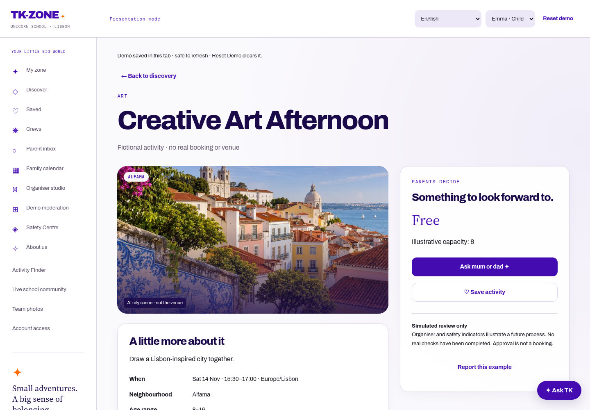

# City imagery and sharing

## Provenance and truthful presentation

The rooftop/Tagus and riverside/garden scenes were generated for TK-ZONE using the image generation tool on 10 November 2026. They are photorealistic **AI-generated Lisbon-inspired illustrations**, not documentary photographs, actual activity venues, confirmed accessibility evidence or photographs taken by students. No identifiable children or other people are depicted.

Photo-source downloads from Wikimedia Commons and Unsplash were blocked by this environment. No blocked-source photos have been copied, hotlinked, credited as if licensed or bundled. The generated scenes provide an interim visual treatment; real licensed school-approved Lisbon photographs can replace the WebP assets later.

Cards and details explicitly display **AI city scene · not the venue**, with descriptive alternative text. Portuguese labels are included. Uploaded organiser photos retain priority and continue to use protected media access. Private activity permissions remain unchanged.

## Assets

`static/community/imagery/` contains two scenes in 768px and 1536px WebP widths. Small images are under 150KB each. Standard image encoding strips metadata; CSS handles presentation crops. Fixed dimensions, responsive `srcset`, lazy loading and asynchronous decoding avoid layout shifts and third-party image requests. Sources remain outside the application checkout in `/workspace/generated_images/`; original generation files are not needed at runtime.

`community/city_imagery.py` supplies safe static URLs for live templates and the demo JSON manifest. Demo submissions gain a cover without persisting generated image paths in the session journal.

## Shared-link preview

`tk-zone-share.png` is a checked-in 1200 × 630 branded composition with the school name, mission and disclosed generated city image. `scripts/share-preview.html` is its editable layout; run `python scripts/render-share-preview.py` with development Playwright/Chromium installed to regenerate it. This uses a loopback-only development HTTP server, not an application endpoint.

Shared base/demo templates render Open Graph and Twitter large-image metadata on the server. The PNG is served publicly as a static asset without authentication or client-side JavaScript. All previews use generic project copy, never private activity details, child profiles or query strings.

`PUBLIC_SITE_URL` defaults to `https://school-choice-app-hrvb.vercel.app`. For a future custom domain, set it to the HTTPS origin only and redeploy. Metadata deliberately uses this trusted setting rather than the incoming Host header.

## Verification and platform limits

The imagery tests check uploaded-image priority, school visibility, explicit disclosure, Portuguese captions, asset dimensions/weight, absolute generic metadata, responsive browser layouts and anonymous PNG retrieval. Browser checks include real image decoding.

Actual WhatsApp and LinkedIn rendering can only be confirmed after the deployment is Ready and their crawlers fetch it. Existing shared messages may retain an old preview; LinkedIn Post Inspector can request a fresh scrape. The app cannot force third-party preview cache invalidation.

Local verification completed: 237 Django tests, 27 Chromium journey tests, 25 JavaScript tests, JavaScript syntax and diff checks, and the Vercel preview build command passed. Third-party sharing crawlers and the hosted deployment have not been verified from this environment.

